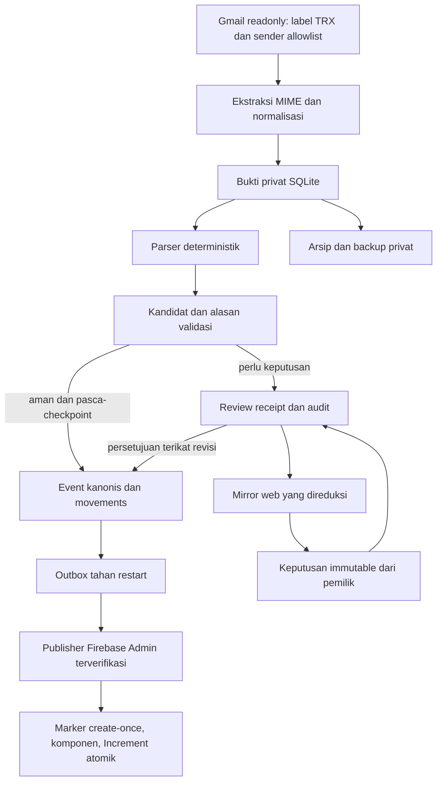
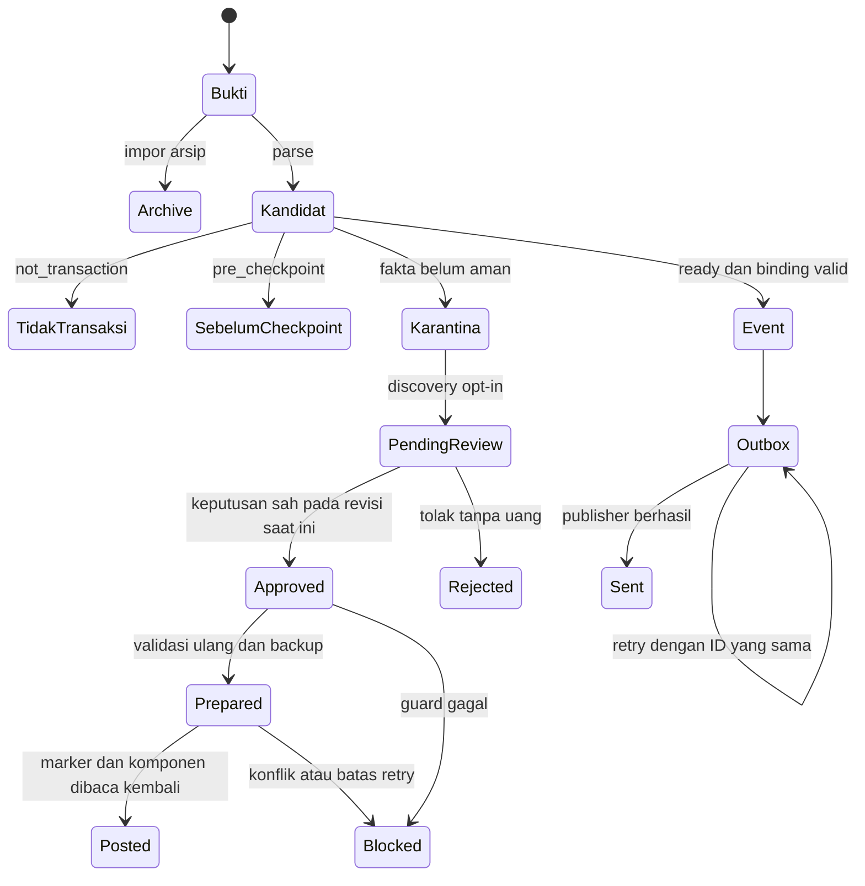

# Arsitektur, model data, dan kontrak keuangan

## Aliran pemrosesan



Worker merupakan proses lokal/terjadwal, bukan backend HTTP baru. Frontend BudgetX tetap membaca skema Firestore existing. n8n/Hermes hanya mengorkestrasi pemanggilan yang sama; keduanya bukan mesin saldo baru. LLM tidak terlibat dalam parsing, kepemilikan endpoint, nominal, status final, deduplikasi uang, atau publisher. Klasifikasi kategori tujuan dengan Hermes adalah fitur opsional yang dipisahkan dari jalur finansial.

## Batas kepercayaan

1. Email/body, header, subject, nama merchant dan input browser adalah data tidak tepercaya. Sender allowlist mengendalikan cakupan akuisisi, bukan bukti kepemilikan atau otorisasi finansial.
2. Registry privat dan checkpoint yang disetujui menjadi basis endpoint dan cakupan waktu. Identitas tidak dikenal tetap `UNRESOLVED`; `EXTERNAL` berarti endpoint luar yang semantiknya telah ditetapkan, bukan fallback untuk semua data hilang.
3. Ledger menyimpan bukti asli, kandidat, event, dan outbox. Mirror web hanya proyeksi allowlist; bukan sumber nominal, revisi, status atau registry.
4. Keputusan administrator/pemilik harus sesuai channel, receipt dan revisi saat ini. Handler keputusan hanya menulis antrean/audit, bukan saldo.
5. Publisher memverifikasi project serta Firebase Auth email/UID. IAM Admin SDK tetap harus dibatasi; rules browser tidak mengamankan service account.

## Akuisisi dan MIME

- Gmail memakai label `TRX`, alamat sender persis, history `messageAdded`/`labelAdded`, semua halaman, serta deduplikasi ID. Jumlah estimasi Gmail bukan ukuran hasil yang sah.
- Evidence menggunakan key `(account_id, gmail_message_id)`. Metadata diverifikasi dahulu; full MIME diambil untuk pesan baru yang relevan. Body plain/HTML dinormalisasi dengan ekstraktor lokal `harvest.py`, termasuk body attachment-backed. Lampiran biasa tidak dianggap body transaksi.
- Batch bukti/kandidat/event/outbox dan pembaruan cursor/`last_success` dikomit atomik. Kegagalan jaringan/MIME umum tidak boleh memajukan cursor melewati bukti yang belum selesai.
- HTTP 404 pada fetch **seluruh pesan** tahap metadata/full dapat dicatat sebagai unavailable-message audit privat lalu dilanjutkan; bukan membuat bukti palsu. Ini berbeda dari 404 history cursor, label atau lampiran.
- Cursor history kedaluwarsa memakai pencarian overlap yang dibatasi waktu dan semua halaman; high-water cursor diambil sebelum pencarian. Gap melebihi `recovery_max_days` gagal tertutup untuk rekonsiliasi manual.
- Bootstrap menyimpan cursor awal sebelum impor arsip. Arsip hanya bukti non-posting, tidak memproses ulang saldo pembuka.

## Skema penyimpanan

Ledger utama berada pada `config.db_path`, bukan nama database yang diasumsikan dari checkout. Namespace finansial `scope = project_id + ':' + uid`.

| Tabel | Key/isi utama | Peran |
| --- | --- | --- |
| `mailbox` | `account`, `email`, `cursor`, `last_success` | Posisi akuisisi |
| `evidence` | `(account,message)`, `raw` JSON, `archive` | Bukti asli privat |
| `candidates` | `(scope,account,message)`, `parsed` JSON, `reason`, `event_id` | Hasil parser dan gerbang validasi |
| `events` | `(scope,id)`, provider/reference/facility/signature/time/parsed/state | Identitas event finansial kanonis |
| `event_evidence` | `(scope,event_id,account,message)` | Banyak receipt untuk satu event |
| `movements` | `(scope,event_id,wallet,field)`, `delta` integer | Efek saldo/hold |
| `checkpoints`, `registry`, `aliases` | scope dan basis waktu/endpoint | Kontrak yang harus stabil |
| `outbox` | `(scope,event_id)`, payload/state/attempts/next_attempt/error | Pengiriman tahan restart |
| `job_runs` | scope, started/finished/status/detail | Hasil delta dan audit akuisisi |
| `category_cache` | `(scope,id)`, body | Katalog kategori terverifikasi |
| `archive_imports`, `holds` | penanda impor; tautan hold/final event | Bukti arsip dan siklus hold |

`candidates` tidak memiliki kolom `amount`, `subject` atau `sender`; baca dari `parsed` JSON atau join bukti. `job_runs` bukan catatan lengkap kegagalan sebelum delta dimulai, misalnya error refresh token.

Store auxiliary terpisah:

- Whitelist tujuan: keputusan kategori/tag, observasi, antrean dan provenance per scope. Bukan whitelist kepemilikan wallet.
- Worker kategori: tabel `jobs`/`audit` untuk inferensi, retry, keputusan dan notifikasi. Status yang relevan antara lain `deferred`, `admin_pending`, `approved`, `dismissed`.
- Review receipt: `reviews`, `commands`, `audit`, `notices`. Menyimpan fingerprint bukti, revisi, keputusan channel, acknowledgement dan retry; tidak mengganti ledger utama.
- JSON operasional: `ops-run.json`, `ops-alerts.json`, `category-corrections.json`, dan state tambahan yang memang dipakai versi terpasang.

SQLite memakai lock proses, transaksi, WAL pada ledger dan `synchronous=FULL`. Lock tidak membenarkan dua scheduler: auxiliary store dan notifikasi juga memiliki urutan/lock sendiri.

## Kontrak parser

`parse_email(row, registry)` bersifat pure, tanpa jaringan, dataset tersembunyi atau kredensial. Input bukti antara lain `account_id`, `gmail_message_id`, `from`, `subject`, body ternormalisasi dan waktu notifikasi. Output memiliki field nullable yang stabil:

```text
is_transaction, eligible, event_type, status
source_wallet, destination_wallet, destination_flag
source_identity, destination_identity
amount, currency, fee_displayed, fee_paid, total_debit, total_credit
reference, facility, notification_at, time_source, body_transaction_at
raw_fields, validation_errors, category_hint, note, provenance
ownership_candidates, collected_at
```

Nominal IDR adalah integer rupiah positif; fee/total integer nonnegatif atau `null`. Boolean bukan nominal. `fee_paid=null` berarti belum diketahui/tidak disebut, **bukan** bukti biaya nol. Engine dapat mengizinkan principal-only untuk template tervalidasi tanpa bukti biaya terbayar; fallback hitung nol tidak boleh menulis ulang evidence atau menciptakan komponen fee. Biaya tertera tetapi pembayarannya tidak pasti, total kontradiktif, status tidak final atau waktu tidak valid tetap menahan transaksi.

Waktu notifikasi kanonis berasal dari metadata yang didukung parser; waktu body disimpan terpisah untuk audit/rekonsiliasi. Tanggal komponen dibuat dalam `Asia/Jakarta`. Reference, transaction ID dan order ID tidak boleh digabung sembarang.

## State machine dan review



Diagram adalah alur konseptual, bukan satu enum tabel. `ready` belum membuktikan event terikat; periksa `event_id` dan `event_evidence`. `sent` jalur biasa dan `posted` review berbeda: processor review wajib memverifikasi readback marker/komponen/effect hash sebelum acknowledgement akhir.

Review mengikat keputusan ke fingerprint yang mencakup target, checkpoint, registry, alasan, parsed dan raw evidence. Revisi berubah berarti keputusan lama tidak berlaku untuk bukti baru. Delivery review untuk event yang sudah terikat bukan izin membuat event finansial baru. Review-created events memiliki satu retry owner: processor review, bukan drain outbox biasa, termasuk drain paksa. Penolakan/retry browser dan immutability revisi dijelaskan pada [kontrak web](web-review.md).

`archive`, `pre_checkpoint`, `not_transaction` tidak dihitung sebagai karantina; `ready` juga dikecualikan oleh counter. Ini definisi counter, bukan jaminan template lengkap. Kandidat historis `not_transaction` dan `ready` tanpa binding tidak termasuk retry parser normal; pemulihannya harus scoped dan disetujui.

## Semantik uang

- `income`: sumber `EXTERNAL`, wallet tujuan milik pengguna menerima principal.
- `expense`: wallet sumber milik pengguna berkurang; tujuan `EXTERNAL`.
- Transfer internal: dua wallet yang kepemilikannya terkonfirmasi, principal mengurangi sumber dan menambah tujuan. Transfer principal tetap tanpa kategori.
- Pembayaran merchant/penjual adalah expense eksternal, meskipun receipt memakai kata transfer atau nama merchant menyerupai bank/wallet. Kategori bernama `Transfer` tidak membuatnya internal.
- **ATM Krom:** expense dari wallet Krom dengan konfirmasi alias kartu tersamarkan yang tepat ke `EXTERNAL`. Alias bank umum/kartu lain tidak cukup. Tidak membuat/mengkredit wallet tunai, menebak tujuan belanja, atau memperluas konfirmasi satu receipt menjadi alias global.
- **BRIZZI/kartu:** kebijakan kategori/tag yang disetujui berlaku hanya pada identitas kartu persis. Jangan menggeneralisasi kartu yang lain atau menampilkan nomor kartu privat di dokumentasi/fixture baru.
- Biaya yang benar-benar dibayar dapat menjadi komponen expense terpisah. Tampilan biaya/waiver bukan bukti biaya terbayar; jangan membuat fee dari ketiadaan.
- Kredit/paylater memakai saldo bertanda; expense menurunkan saldo (utang bertambah), pelunasan menambah saldo kredit lewat transfer. `creditLimit` tidak diubah. Hold memengaruhi `heldAmount`, bukan saldo/pengeluaran; pelepasan membutuhkan tautan hold unik dan marker cloud. `heldAmount` tidak boleh negatif.
- Reversal/cancellation tidak otomatis diubah menjadi kompensasi saldo. Koreksi kategori tidak boleh menyentuh nominal, endpoint, tipe, marker, checkpoint atau hold.

## Deduplikasi dan publikasi atomik

Deduplikasi Gmail hanya memastikan bukti unik, bukan event uang unik. Event kanonis memakai provider/reference/facility dan signature keuangan yang kompatibel; transfer berlawanan arah tidak digabung. Kecocokan lintas-provider membutuhkan endpoint terkonfirmasi dan pasangan unik dalam jendela yang dibatasi; kasus ambigu/fee tidak konsisten dikarantina. Nama pemilik saja hanya dapat membantu rekonsiliasi evidence yang konservatif, bukan membuat income atau kepemilikan baru.

Publisher membaca dokumen event-local sebelum write, lalu memakai **satu Firestore transaction** untuk:

```text
users/{uid}/mesh_events/demo-{event_id}               marker create-once
users/{uid}/mesh_state/demo-checkpoint               basis checkpoint
users/{uid}/transactions/demo-mesh-{event_id}-{i}     komponen deterministik
users/{uid}/wallets/{wallet_id}                      Increment(balance/heldAmount)
```

Komponen kompatibel dengan BudgetX: `date`, `walletId`, `type`, `categoryId`, `amount`, `note`, `tags`, `toWalletId`, dan metadata `mesh`. Marker menyimpan hash efek immutable. Retry setelah cloud commit tetapi sebelum acknowledgement lokal menemukan marker yang sama: hanya enrichment evidence, **tidak mengulang Increment**. Komponen tanpa marker, wallet hilang, checkpoint mismatch atau hash efek berubah gagal tertutup untuk rekonsiliasi, bukan alasan membuat ID baru.

Semua perubahan kategori menggunakan jalur correction-only dengan precondition/compare-and-set dan perlindungan edit manual. Enrichment evidence tidak menulis ulang komponen hasil edit pengguna. Menghapus transaksi di frontend tidak menghapus marker dan tidak mengizinkan resurrect/replay uang.
